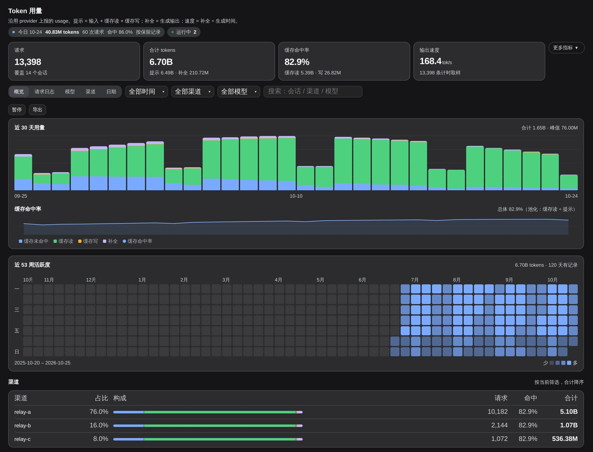
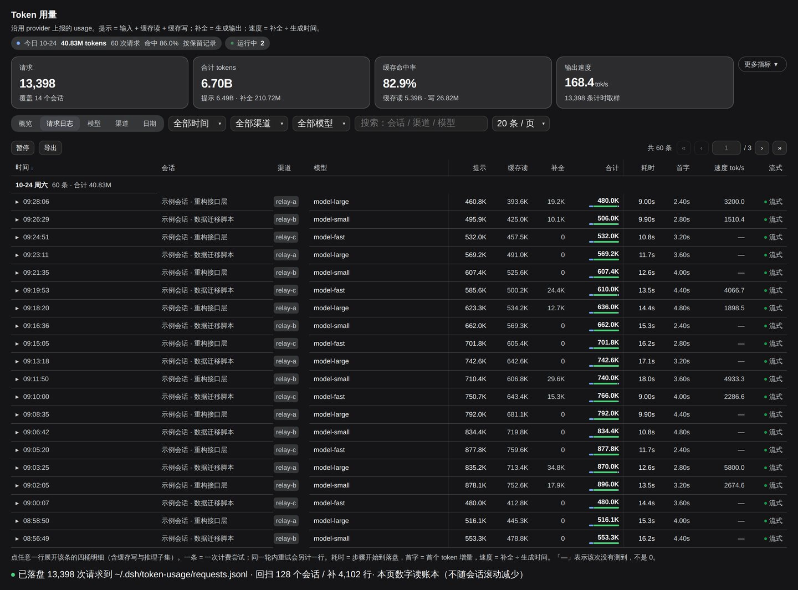
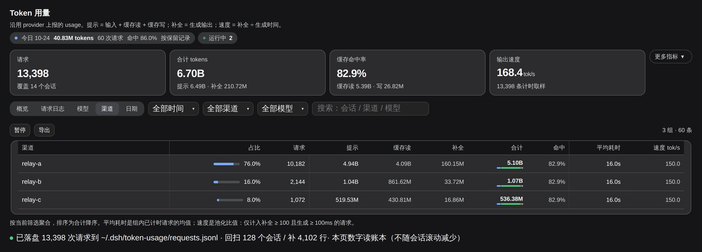

# dsh-token-usage

**Token 用量面板，为 DeepSeek Harness（DSH）的 Web GUI 而做。**

逐请求账本 · 四桶计量 · 全年热力图 · 实时并发，以及一份**落盘账本**——它让用量记录不再随会话滚动而消失。

<p align="center">
  
</p>

---

## 它解决什么问题

DSH 的 durable session log 里其实**已经**记着每次调用的 provider 计费用量，但没有任何页面把它摊开：用了多少、花在哪、什么时候用的，都看不见。

更麻烦的是，会话投影每个会话只保留**最近 600 行**。会话一长、或者会话被删，早期用量就从界面上消失了——数字变小，但数据从来没丢，只是没人再去读它。

这个插件做两件事：

1. 把那份权威数据折成一张**请求日志**，一次计费尝试一行；
2. 额外落一份**盘上账本**，不受投影窗口限制，并在启动时从全部会话日志回扫补齐。
## 功能

### 概览

- 四张主指标卡：请求数、合计 tokens、缓存命中率、输出速度；「更多指标」展开四桶明细、平均耗时、平均首字
- **趋势图**：按桶堆叠的柱子，与**同一根 x 轴**上的缓存命中率折线。两者永远读同一个数据源、同一个窗口——一眼能看出哪次改动把缓存打掉了
- **全年热力图**：53 周 × 7 天，铺满卡片宽度，月/周标签齐全
- **渠道排行**：占比、四色构成条、请求数、命中率、合计
- 标题下的**今日**读数（不随筛选变化）与**实时并发**

### 请求日志

<p align="center">
  
</p>

- 12 列逐请求明细：时间 / 会话 / 渠道 / 模型 / 提示 / 缓存读 / 补全 / 合计 / 耗时 / 首字 / 速度 / 流式
- 按天分组的**粘性日期条**，表头与日期条都随滚动钉住
- 点任意一行展开该条的四桶明细（含缓存写、推理子集、轮次与步骤）
- **点会话名直接跳到那个对话**
- 筛选：时间范围 / 渠道 / 模型 / 全文搜索；**暂停**冻结表格而顶部数字照常更新
- 列头点击排序、CSV 导出、页码直达

### 分组视图

<p align="center">
  
</p>

模型、渠道、日期三张表共用一套列：占比（带条）、请求、提示、缓存读、补全、合计（带四色构成条）、命中率、平均耗时、速度。

### 实时并发

标题下的活体指示 `● 运行中 N`，数据来自会话列表自带的 `running` 标志——Host 推送，不是轮询。

一个会话里同时有多个调用在飞时，追加 `· M 步在飞`：Host 按 `step/start` → 结算事件计数，`turn/end` 清空。会话的 `running` 是布尔值，说不出一段对话里有几个调用在跑，这个计数可以。
## 安装

插件是一个普通的 DSH bundle，纯 JS，**无构建步骤**。

```bash
git clone https://github.com/menglian001/dsh-token-usage.git ~/dsh-token-usage

# 1) 装插件自己的依赖（必做，见下）
cd ~/dsh-token-usage && npm install

# 2) 在 profile 里登记，然后安装
cd ~/.dsh/profiles/web
pnpm install
```

profile 的 `package.json` 需要这两处：

```jsonc
{
  "dependencies": {
    "dsh-token-usage": "link:~/dsh-token-usage"
  },
  "dsh": {
    "profile": {
      "bundles": ["...", "dsh-token-usage"]
    }
  }
}
```

然后重启 dsh。

> **为什么第 1 步必做**
> `link:` 包按**真实目录**解析依赖，不经过 profile 的 `node_modules`。插件目录里没有 `node_modules/zod` 时，Host 半会以 `Cannot find package 'zod'` 加载失败——而 Host 半失败会连带 Client 半不注入，表现是侧边栏根本没有这个图标。`npm install` 只装一个 `zod`，几秒钟。
>
> **Host 半改动需要重启**才生效；Client 半热更新，刷新页面即可。
## 数据从哪来

| 数字 | 来源 |
|---|---|
| 四桶（未命中输入 / 缓存读 / 缓存写 / 补全）与推理 | **provider 回包上报**，不是估算 |
| 提示 / 补全 / 合计 / 缓存命中率 | 四桶的算术 |
| 耗时 / 首字 / 生成时间 | **本地时钟**，含网络往返，不是上游服务端延迟 |
| 输出速度 | 补全 ÷ 生成时间，池化；仅计入补全 ≥ 100 且生成 ≥ 100 ms 的请求 |

链路：provider 响应 → `stream.ts` 的 `usage` 事件 → `assembler` → `assistant/message.data.usage` → 本插件的 `requestLog` 投影。

走中转时，"准确"的含义是**忠实反映中转上报的数字**。中转少报，面板就跟着少报。

## 落盘账本

每次请求结算时追加一行 JSONL 到 `$DSH_HOME/token-usage/requests.jsonl`。

- **键**：`session|turn|step|attempt`，读时后写覆盖。崩溃重放、重复回扫都不会重复计数
- **回扫**：启动后读遍磁盘上的全部会话日志，把投影窗口早已丢掉的行补回来
- **保留** 730 天
- **压实**：启动时若文件 ≤ 32 MB 且（总行数 ≥ 2000 且 总行数 > 唯一键数 × 1.25，即重复行占比 > 20%；或存在超 730 天的记录）则压实（写临时文件再 rename）。超过 32 MB 的文件只读、不再压实

数据有两条来源，页脚会说明当前用的是哪条：

- **账本**：保留窗口内只增不减，但只有聚合（天 / 模型 / 渠道）与最近若干行明细（服务端留 2000 行，面板按需取 400 行）
- **保留记录**：浏览器手里的投影行，能按任意条件切片，但受每会话 600 行窗口约束

切换规则只看**完整性**：账本尝试数 ≥ 保留行数，且无筛选时读账本。天数跨度不参与判断——图表的天数下限是画图用的，不能拿来仲裁数据源。
## 已知边界

- **缓存写 / 推理恒为 0**：上游若为 OpenAI 口径（prompt 里已含缓存命中），不会单独上报 `cache_creation` / `reasoning`。显示 0 是没报，不是漏读
- **速度显示 `—`**：中转把首字和落盘报在同一瞬间时，生成时间≈0，除出来的速度是假的，因此按门槛显示 `—`。`—` 表示"没测到"，不是 0
- **请求日志明细受投影窗口约束**：明细仍读投影（每会话 600 行）；分组视图与趋势在无筛选时读账本聚合，不会缩水
- **热力图空格 = 那天没有记录**，不是"那天没用"
- **账本从启用那天开始记**：更早且日志已被清理的会话，总数可能补回，明细补不回来

## 架构

```
index.js    Host 半
            ├─ requestLog 会话投影        一次计费尝试一行
            ├─ Ledger                     JSONL 落盘 + 内存聚合（天/模型/渠道/会话）
            ├─ 磁盘回扫                   sessionPersistence.list() → 逐会话 read() → 补写
            ├─ LiveSteps                  在飞步骤计数
            └─ GET /token-usage/ledger    浏览器 cookie 鉴权，失败关闭

client.js   Client 半（纯 JS，React.createElement，无构建）
            ├─ 三个槽位                   侧边栏 / 主面板 / 设置页
            ├─ 投影补拉 pump              游标轮转，避免老会话饿死
            └─ 视图                       概览 / 请求日志 / 模型 / 渠道 / 日期
```

## 开发与校验

纯 JS，没有构建。校验脚本在 `test/`，Node 直接跑，不依赖 dsh：

```bash
npm install       # 装 zod（仅测试/开发需要）
npm test          # 跑 11 套离线校验
node test/render-check.mjs   # 跑单个

# 安装验收：把本包当成陌生用户从零装一遍
node test/install-check.mjs
# 或随套件一起跑
DSH_TU_INSTALL_CHECK=1 npm test
```

覆盖：投影折叠语义、账本写入 / 覆盖 / 压实 / 回扫幂等、聚合视图切换、pump 覆盖率、面板渲染（含空数据与缺 seat 的降级）、在飞步骤计数。

`install-check` 单独存在是有原因的：其余 harness 都在本仓库内 `import ../index.js`，那里 `node_modules` 已经存在，恰好掩盖了唯一真把人绊倒的失败模式。这个 harness 用 `git archive` 造出干净树、经 `link:` 解析、先断言 import **必须失败**、装完依赖再断言**必须成功**。

截图可以重新生成（需要 Playwright 与一个本地 Harness checkout）：

```bash
node scripts/screenshots.mjs --harness ../deepseek-harness
```
## English

A token-usage panel for the DeepSeek Harness Web GUI. It folds the Harness's own
provider-reported usage into a per-request ledger and keeps a durable copy on
disk, because a session projection only retains the newest 600 rows per session.

- **Overview** — four headline cards, a stacked-by-bucket trend with the cache-hit
  line on the same x axis and the same source, a 53-week heat map, a channel ranking.
- **Request log** — one row per billed attempt (12 columns) under sticky day rules,
  expandable into the four-bucket breakdown, sortable, filterable, pausable, CSV
  export; a session name opens its conversation.
- **Model / channel / day tables** — share, requests, prompt, cache read, completion,
  total with a composition bar, hit rate, latency, speed.
- **Live concurrency** — the session list's `running` flag, plus a Host-side count of
  open steps, so several calls in flight inside one conversation are visible.
- **Durable ledger** — every settled request is appended to
  `$DSH_HOME/token-usage/requests.jsonl`, keyed by `session|turn|step|attempt`
  (last write wins), swept from every stored session log at startup, retained for
  730 days, compacted at startup when it is small enough.

**Install** — clone it, run `npm install` inside the clone (a `link:` package
resolves its dependencies from its real directory, so without it the Host half
fails with `Cannot find package 'zod'`), add `"dsh-token-usage": "link:~/dsh-token-usage"`
to your profile dependencies and `dsh-token-usage` to `dsh.profile.bundles`, run
`pnpm install`, restart dsh.

**Tests** — `npm install` then `npm test` runs the offline harnesses in `test/`.

## License

[MIT](LICENSE)
